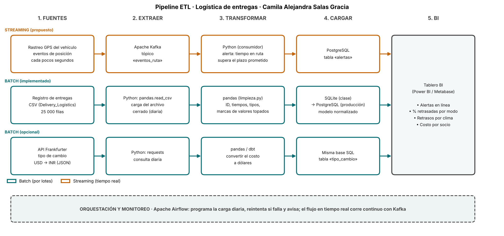

# Semana 8 · Pipeline ETL de la logística de entregas

```python
FULL_NAME   = "Camila Alejandra Salas Gracia"
GITHUB_USER = "casalas-2024a-cell"
```

Asignatura: Ciencia de Datos · Ingeniería Industrial · CORHUILA · 2026-B · Corte 2.
Guía de la actividad: *Semana 8 · Conexión de datos: APIs, ETL y pipelines* (formativa, opcional).

## Qué se entrega

| Archivo | Contenido |
|---|---|
| [`pipeline_etl.png`](pipeline_etl.png) | Diagrama del pipeline con la herramienta de cada paso |
| [`pipeline.mmd`](pipeline.mmd) | El mismo diagrama en Mermaid (editable) |
| [`consumir_api.py`](consumir_api.py) | Consumo de una API pública con `requests`; muestra 3 registros (parte opcional) |
| [`api_sample.json`](api_sample.json) | Muestra guardada de la respuesta de la API, usada como respaldo |
| [`dibujar_pipeline.py`](dibujar_pipeline.py) | Genera la imagen del diagrama |

## 1. Pipeline: fuentes → extraer → transformar → cargar → BI



| Paso | Batch (por lotes) | Streaming (tiempo real) |
|---|---|---|
| **Fuentes** | CSV del registro de entregas; API Frankfurter (tipo de cambio) | Eventos de posición GPS del vehículo |
| **Extraer** | `pandas.read_csv`; `requests` | Apache Kafka, tópico `eventos_ruta` |
| **Transformar** | `pandas`: ID, tiempos, tipos y marcas de valores topados ([`limpieza.py`](../09-week/limpieza.py)); `pandas`/`dbt` para convertir el costo a dólares | Consumidor en Python: alerta cuando el tiempo en ruta supera el plazo prometido |
| **Cargar** | SQLite en clase → PostgreSQL en producción, con el modelo de la [semana 6](../06-week/README.md) | Tabla `alertas` en PostgreSQL |
| **BI** | Power BI o Metabase: % retrasadas por modo, retrasos por clima, costo por socio | Panel de alertas en línea |
| **Orquestación** | Apache Airflow programa la carga diaria, reintenta y avisa si falla | Kafka corre de forma continua |

**Qué está implementado y qué es diseño.** El flujo por lotes del CSV sí existe (semanas 6, 7 y 9, integradas en la [semana 10](../10-week/README.md)). El streaming es una **propuesta**: el archivo no trae posiciones ni marcas de tiempo, solo el resultado de cada entrega.

## 2. Batch vs. streaming: justificación

| Parte | Elección | Por qué |
|---|---|---|
| **Registro de entregas** | Batch | Cada fila describe una entrega ya terminada (estado final, calificación). Los indicadores de gestión (retrasos por modo, costo por socio) se calculan bien con un corte diario. |
| **Limpieza** | Batch | Validaciones como «el ID es único» o «el estado es coherente con `delayed`» necesitan ver el lote completo. |
| **Tipo de cambio** | Batch | El Banco Central Europeo publica una tasa por día hábil; consultarla más seguido no aporta datos nuevos. |
| **Alertas de ruta** | Streaming (propuesto) | Saber que un paquete *va a* llegar tarde sirve mientras todavía está en camino; hacerlo al día siguiente solo documenta el retraso. |

**Por qué no pasar todo a streaming:** añade Kafka, más piezas que operar y más puntos de falla, sin beneficio para métricas que se miran por día.

**Un detalle del caso que condiciona la alerta:** en los datos, el tiempo real de entrega promedia unas 6,2 horas en los cuatro modos, pero el plazo prometido varía de 2–7 h (*express*) a 24 h (*standard*). Una regla «tiempo en ruta > plazo» saltaría casi siempre en *express* (65 % de sus entregas superan su plazo) y casi nunca en *standard*. Antes de ponerla en producción habría que revisar si esos plazos son realistas. El umbral no se calibró con datos de ruta, porque no los hay.

## 3. Consumo de una API (parte opcional)

`consumir_api.py` consulta la API pública **Frankfurter** (tasas del Banco Central Europeo, sin llave) y pide USD → INR de tres días hábiles. Es un **ejemplo de enriquecimiento**: el costo del dataset no declara moneda, y si estuviera en rupias (es un supuesto mío, por ser varios socios operadores de India) este tipo de cambio permitiría expresarlo en dólares.

```bash
python consumir_api.py
```

Salida (3 registros, uno por fecha):

| fecha | base | INR_por_USD |
|---|---|---:|
| 2026-10-12 | USD | 95.78 |
| 2026-10-13 | USD | 95.28 |
| 2026-10-14 | USD | 95.16 |

El script sigue el ciclo de ETL en miniatura: `extraer()` hace la petición con `requests`, `transformar()` convierte el JSON anidado a tabla y el resultado se guarda en `muestra_api_3_registros.csv`.

**Cómo se probó (para que no haya malentendidos):**

- Las tres tasas se leyeron de una consulta real a la API el 2026-10-14 con una herramienta de lectura web, que las devolvió resumidas y no como JSON literal. En `api_sample.json` puse esas tres cifras dentro de la estructura que documenta Frankfurter (`amount`, `base`, `start_date`, `end_date`, `rates`), que reconstruí yo.
- Desde el entorno donde ejecuté el script **no había salida a internet** (error de proxy), así que lo que corrió fue la ruta de **respaldo**, y el script lo avisa. La ruta «en vivo» (`requests.get`) está escrita pero **no la pude ejecutar aquí**; conviene correrla una vez con conexión.
- No convertí el costo del dataset: la moneda sigue sin saberse.

## 4. Referencias

CORHUILA. (2026). *Ciencia de Datos · Semana 8 · Conexión de datos: APIs, ETL y pipelines* [Material de clase]. Corporación Universitaria del Huila. https://code-corhuila.github.io/ova-web/2026-B/ciencia-datos/08-week/01-session/

Frankfurter. (s. f.). *Frankfurter: Currency data API*. https://frankfurter.dev/

Kimball, R., y Ross, M. (2013). *The data warehouse toolkit: The definitive guide to dimensional modeling* (3.ª ed.). Wiley.

Kleppmann, M. (2017). *Designing data-intensive applications*. O'Reilly Media.

Mermaid. (s. f.). *Flowchart syntax*. https://mermaid.js.org/syntax/flowchart.html

Reitz, K. (s. f.). *Requests: HTTP for humans* [Documentación]. https://requests.readthedocs.io/en/latest/

The Apache Software Foundation. (s. f.). *Apache Airflow documentation*. https://airflow.apache.org/docs/

The Apache Software Foundation. (s. f.). *Apache Kafka documentation*. https://kafka.apache.org/documentation/
