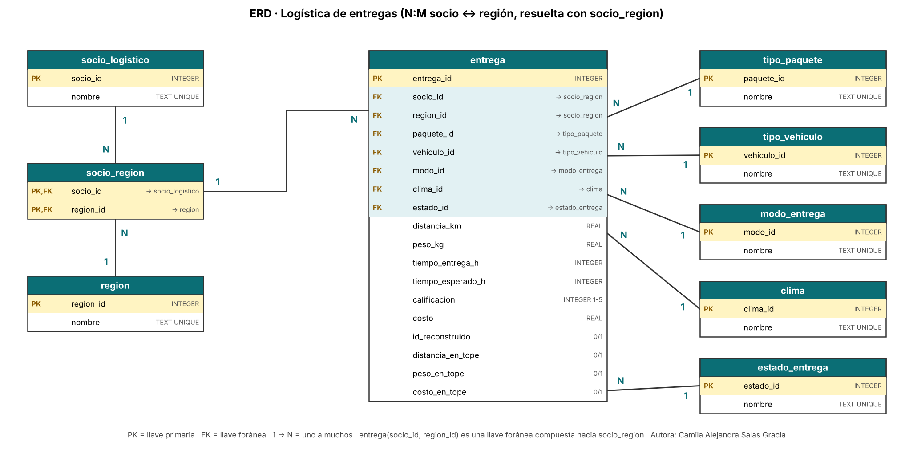
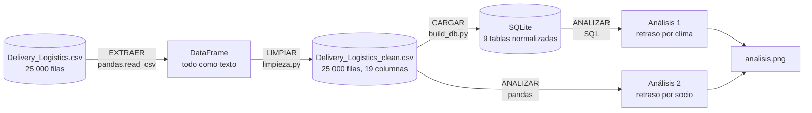

# Semana 10 · Mini-proyecto de datos (cierre del Corte 2)

```python
FULL_NAME   = "Camila Alejandra Salas Gracia"
GITHUB_USER = "casalas-2024a-cell"
```

Asignatura: Ciencia de Datos · Ingeniería Industrial · CORHUILA · 2026-B · Corte 2.
Guía de la actividad: *Semana 10 · Repaso y evaluación del Corte 2* (formativa, opcional).

**Caso:** una operación de logística de última milla (25 000 entregas, 9 socios, 5 regiones). Este mini-proyecto junta, en un solo flujo, lo trabajado en las semanas 6 a 9: modelo de datos, carga y limpieza con pandas, y dos análisis con consultas.

## Qué se entrega

| Archivo | Contenido |
|---|---|
| [`pipeline.py`](pipeline.py) | El flujo completo: extraer → limpiar → cargar → analizar |
| [`data/Delivery_Logistics.csv`](data/Delivery_Logistics.csv) | Dataset original (25 000 filas) |
| [`erd.png`](erd.png) | Modelo de datos (ERD); detalle en la [semana 6](../06-week/README.md) |
| `salidas/Delivery_Logistics_clean.csv` | Datos limpios y listos para analizar (19 columnas) |
| `salidas/logistica.db` | Los mismos datos en la base SQLite normalizada (9 tablas) |
| `salidas/analisis1_retraso_por_clima.csv` | Resultado del análisis 1 (SQL) |
| `salidas/analisis2_retraso_por_socio.csv` | Resultado del análisis 2 (pandas) |
| `salidas/analisis.png` | Gráfica de ambos análisis |

```bash
python pipeline.py     # necesita 06-week y 09-week al lado: reutiliza su código
```

## 1. Modelo de datos (ERD)



Nueve tablas: `entrega` (el hecho), siete catálogos (`socio_logistico`, `region`, `tipo_paquete`, `tipo_vehiculo`, `modo_entrega`, `clima`, `estado_entrega`) y la intermedia N:M `socio_region`. La justificación relacional vs. NoSQL y la normalización están en la [semana 6](../06-week/README.md).

## 2. Flujo documentado: extraer → limpiar → analizar



| Etapa | Función | Qué hace | Resultado medido |
|---|---|---|---|
| **Extraer** | `extraer()` | Lee el CSV crudo como texto, sin interpretar nada | 25 000 filas × 15 columnas |
| **Limpiar** | `limpiar_datos()` → `limpiar()` de la semana 9 | Reconstruye el ID, convierte horas, tipos y banderas, marca los valores topados y valida | ID repetidos 498 → 0 · 500 IDs reconstruidos · columnas 15 → 19 |
| **Cargar** | `cargar()` | Guarda el CSV limpio y lo carga en el modelo de la semana 6; verifica llaves foráneas | 25 000 entregas · 45 pares socio-región · **0** violaciones de llave foránea |
| **Analizar** | `analizar()` | Dos consultas (filtro + agregación) y verificación cruzada SQL vs. pandas | Ver sección 3 |

**Datos listos para analizar:** `salidas/Delivery_Logistics_clean.csv`, sin nulos, con ID único, tiempos en horas y marcas de calidad. El detalle está en la [semana 9](../09-week/README.md).

## 3. Dos análisis con consultas

### Análisis 1 (SQL): ¿cuánto influye el clima en los retrasos?

Filtro: solo el modo *same day* (así el plazo prometido es el mismo, 8 h, y la comparación no se mezcla con los plazos distintos de otros modos). Agregación: % retrasado y calificación por clima.

```sql
SELECT c.nombre AS clima, COUNT(*) AS entregas,
       ROUND(100.0 * SUM(es.nombre <> 'delivered') / COUNT(*), 1) AS pct_retrasadas,
       ROUND(AVG(e.calificacion), 2) AS calificacion_promedio
FROM entrega AS e
JOIN clima          AS c  ON c.clima_id   = e.clima_id
JOIN modo_entrega   AS m  ON m.modo_id    = e.modo_id
JOIN estado_entrega AS es ON es.estado_id = e.estado_id
WHERE m.nombre = 'same day'
GROUP BY c.clima_id, c.nombre
ORDER BY pct_retrasadas DESC, c.nombre;
```

| Clima | Entregas | % retrasadas o fallidas | Calificación prom. |
|---|---:|---:|---:|
| stormy | 1 052 | 65,6 | 2,83 |
| rainy | 1 014 | 52,4 | 3,17 |
| foggy | 1 045 | 34,8 | 3,49 |
| clear | 1 069 | 16,5 | 3,87 |
| hot | 1 033 | 15,1 | 3,91 |
| cold | 1 066 | 11,8 | 3,97 |

**Lectura:** el clima adverso (tormenta, lluvia, niebla) se asocia con muchos más retrasos: de 11,8 % con frío a 65,6 % con tormenta, y la calificación cae en el mismo orden. Con 1 000 a 1 070 entregas por clima, esa diferencia es enorme frente al ruido aleatorio (en una prueba de independencia hecha aparte con `scipy`, el p-valor es prácticamente 0).

**Cautelas:**

- Es una **asociación en este archivo**, no una prueba causal; no hay fechas ni rutas para controlar otros factores.
- «Retrasada» incluye entregas fallidas (estado `failed`), y el campo `delayed` es inconsistente con los tiempos en 1 203 filas (ver semana 9).
- El mismo patrón aparece en los otros modos con retrasos, pero este análisis se limita a *same day* para no mezclar plazos.

### Análisis 2 (pandas): ¿hay un socio logístico claramente peor?

Filtro: se excluyen las 500 entregas con costo topado, para que el costo promedio sea interpretable. Agregación: % retrasado por socio, con **intervalo de confianza del 95 %** (Wilson).

```python
base = limpio[~limpio["costo_en_tope"]]
por_socio = (base.groupby("delivery_partner")
             .agg(entregas=("delayed", "size"), retrasadas=("delayed", "sum"),
                  costo_promedio=("delivery_cost", "mean")))
```

| Socio | Entregas | % retrasadas | IC 95 % | Costo prom. |
|---|---:|---:|---|---:|
| xpressbees | 2 773 | 27,9 | 26,3 – 29,6 | 869,6 |
| ekart | 2 738 | 27,2 | 25,5 – 28,9 | 869,3 |
| shadowfax | 2 677 | 27,0 | 25,4 – 28,7 | 871,0 |
| blue dart | 2 746 | 26,8 | 25,1 – 28,5 | 864,1 |
| amazon logistics | 2 657 | 26,7 | 25,0 – 28,4 | 864,8 |
| ecom express | 2 665 | 26,5 | 24,9 – 28,2 | 869,2 |
| dhl | 2 744 | 26,0 | 24,4 – 27,7 | 873,0 |
| fedex | 2 769 | 24,7 | 23,1 – 26,3 | 855,3 |
| delhivery | 2 731 | 24,5 | 22,9 – 26,1 | 848,6 |

**Lectura:** todos los socios están entre 24,5 % y 27,9 %, un rango estrecho. Los extremos (xpressbees y delhivery) no se solapan, pero fueron elegidos entre 9 socios, y una prueba de independencia global (hecha aparte con `scipy`) da p ≈ 0,07: **no hay evidencia sólida de que algún socio sea peor**. El costo promedio también es casi igual (849 a 873).

**Cautelas:** el orden de la tabla no es un ranking de calidad. Cada socio atiende los mismos modos, climas y regiones en proporciones parecidas, así que no hay una explicación obvia para las pequeñas diferencias.

**Verificación:** el análisis 1 se recalcula en pandas dentro de `pipeline.py` y el script falla si el conteo o el porcentaje no coinciden con SQL. Con estos datos coinciden.

## 4. Limitaciones generales

- Sin fechas ni moneda: no hay análisis temporal ni conversión de costos.
- El ID de 500 entregas está reconstruido y 500 a 510 valores de distancia, peso y costo están topados (marcados, no corregidos).
- Los datos parecen sintéticos (distribuciones casi uniformes; el costo depende casi solo de la distancia), así que los hallazgos describen este archivo, no una operación real.
- No hay análisis causal.

## 5. Cómo se cubre la rúbrica

| Criterio | Dónde está |
|---|---|
| Modelo + carga + limpieza (50) | ERD en la sección 1; carga y limpieza en la sección 2 (`pipeline.py`) |
| 2 análisis con consultas (35) | Sección 3: uno en SQL y otro en pandas, ambos con filtro y agregación |
| Documentación del flujo (15) | Sección 2: diagrama, tabla de etapas con cifras medidas y este README |

## 6. Cómo entregarlo por GitHub

Desde la carpeta de tu fork del repositorio de la clase (`https://github.com/casalas-2024a-cell/electiva-vi-ciencia-datos-2026-b-g1`):

```bash
git add .
git commit -m "Entrega semana 10"
git push
```

## 7. Referencias

Chen, P. P. (1976). The entity-relationship model—Toward a unified view of data. *ACM Transactions on Database Systems, 1*(1), 9–36.

CORHUILA. (2026). *Ciencia de Datos · Semana 10 · Repaso y evaluación del Corte 2* [Material de clase]. Corporación Universitaria del Huila. https://code-corhuila.github.io/ova-web/2026-B/ciencia-datos/10-week/01-session/

McKinney, W. (2022). *Python for data analysis* (3.ª ed.). O'Reilly Media.

Python Software Foundation. (s. f.). *sqlite3 — DB-API 2.0 interface for SQLite databases*. https://docs.python.org/3/library/sqlite3.html

Rahm, E., y Do, H. H. (2000). Data cleaning: Problems and current approaches. *IEEE Data Engineering Bulletin, 23*(4), 3–13.

SQLite. (s. f.). *SQL as understood by SQLite*. https://www.sqlite.org/lang.html

Wang, R. Y., y Strong, D. M. (1996). Beyond accuracy: What data quality means to data consumers. *Journal of Management Information Systems, 12*(4), 5–33.

Wilson, E. B. (1927). Probable inference, the law of succession, and statistical inference. *Journal of the American Statistical Association, 22*(158), 209–212.
