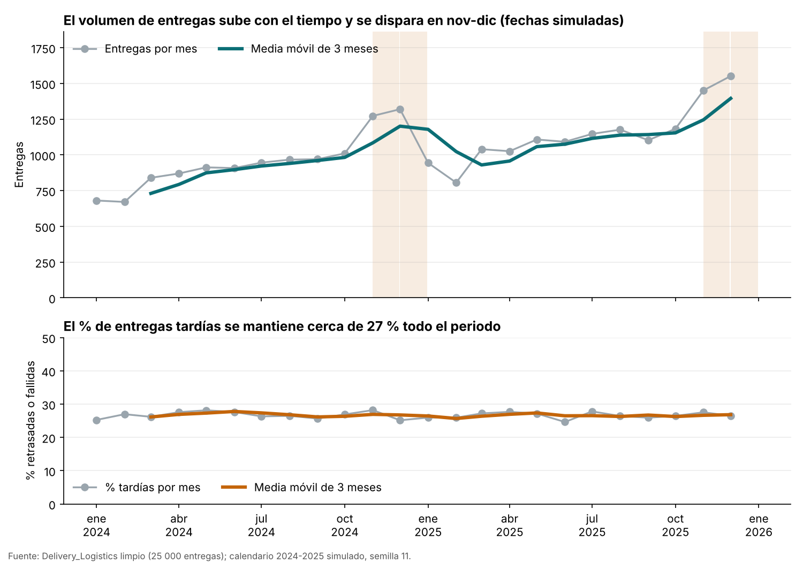

# Semana 11 · Análisis temporal y series de tiempo

```python
FULL_NAME   = "Camila Alejandra Salas Gracia"
GITHUB_USER = "casalas-2024a-cell"
```

Asignatura: Ciencia de Datos · Ingeniería Industrial · CORHUILA · 2026-B · Corte 3.
Guía de la actividad: *Semana 11 · Análisis temporal y series de tiempo* (formativa, opcional, sin nota en Moodle).

**Caso:** el mismo dataset de logística de última milla de las semanas 6 a 10 (25 000 entregas, ya limpio en [`../../10-week/02-optional-activity/salidas/`](../../10-week/02-optional-activity/salidas/Delivery_Logistics_clean.csv)).

## Qué se entrega

| Archivo | Contenido |
|---|---|
| [`serie_temporal.py`](serie_temporal.py) | Script: cargar → `resample` mensual → `rolling` → gráfica → interpretación |
| [`serie_temporal.png`](serie_temporal.png) | Gráfica de la serie con su media móvil |
| [`salidas/serie_mensual.csv`](salidas/serie_mensual.csv) | Serie mensual (entregas, tardías, %, medias móviles) |
| [`salidas/interpretacion.txt`](salidas/interpretacion.txt) | Interpretación generada con las cifras reales del script |

```bash
python serie_temporal.py     # necesita la carpeta 10-week al lado (lee su CSV limpio)
```

## Una aclaración importante: las fechas son simuladas

El dataset **no tiene fecha** (ya se anotó en la semana 10: «sin fechas no hay análisis temporal»). La guía permite una serie real *o simulada*, así que se asignó a cada entrega una fecha de 2024-2025 con semilla fija (`SEMILLA = 11`), con una tendencia suave al alza, temporada alta en noviembre-diciembre, temporada baja en enero-febrero y menos entregas los domingos. **Todo lo demás es dato real del archivo.** Esto condiciona la lectura: la tendencia y la temporada del volumen son las que se pusieron a propósito; lo que se practica es el método.

## Pasos

1. **Cargar:** `pd.read_csv`, columna `fecha` simulada, `set_index("fecha")` y `sort_index()`.
2. **Agregar por mes:** `df.resample("MS").agg(...)` con entregas, entregas tardías (estado distinto de `delivered`, igual que en la semana 10) y costo total.
3. **Media móvil:** `rolling(3).mean()` sobre la serie mensual de entregas y del % de tardías (las dos primeras posiciones quedan vacías porque faltan meses previos).
4. **Gráfica:** dos paneles; arriba el volumen con su media móvil y nov-dic sombreados, abajo el % de tardías con su media móvil.
5. **Interpretación (2-3 líneas):** abajo.



## Interpretación

El volumen mensual sube en promedio unas 24 entregas por mes y tiene una temporada alta clara: noviembre-diciembre promedian 1 399 entregas frente a 970 en el resto del año. En cambio, el % de entregas tardías casi no se mueve (entre 24,6 % y 28,2 %, media 26,7 %), así que **más volumen no significa más retrasos** en estos datos y no hay estacionalidad en el retraso. Como las fechas son simuladas, la tendencia y la temporada son las que se pusieron a propósito; en datos con fecha real habría que repetir el análisis.

## Cómo se cubre la rúbrica

| Criterio | Dónde está |
|---|---|
| Carga y agregación temporal (40) | Pasos 1 y 2 en `serie_temporal.py` (`set_index`, `resample("MS")`) |
| Media móvil y gráfica (35) | Paso 3 (`rolling(3)`) y `serie_temporal.png`, con títulos que dicen la conclusión |
| Interpretación de tendencia y estacionalidad (25) | Sección anterior (cifras tomadas de la serie) |

## Cómo entregarlo por GitHub

Desde la carpeta de tu fork (`https://github.com/casalas-2024a-cell/electiva-vi-ciencia-datos-2026-b-g1`):

```bash
git add 11-week
git commit -m "Entrega semana 11"
git push
```
