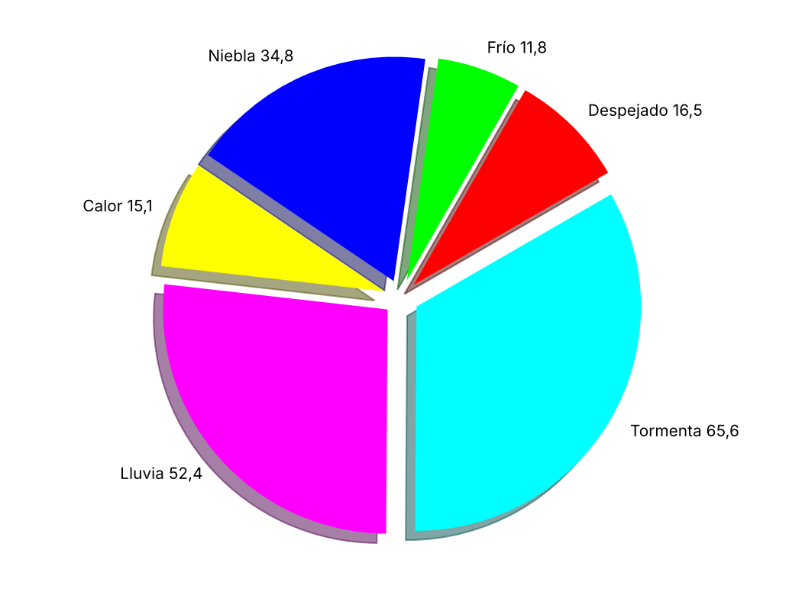
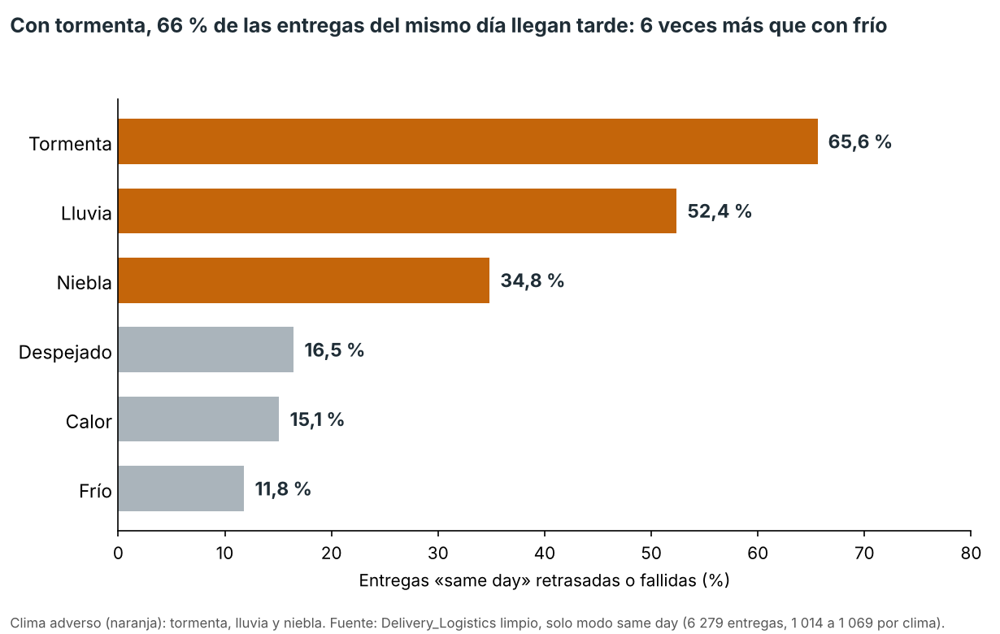

# Semana 12 · Rediseña un gráfico

```python
FULL_NAME   = "Camila Alejandra Salas Gracia"
GITHUB_USER = "casalas-2024a-cell"
```

Asignatura: Ciencia de Datos · Ingeniería Industrial · CORHUILA · 2026-B · Corte 3.
Guía de la actividad: *Semana 12 · Rediseña un gráfico* (formativa, opcional, sin nota en Moodle).

**Caso:** el análisis 1 de la semana 10 (dataset de logística de última milla): % de entregas retrasadas o fallidas según el clima, solo en el modo *same day* para que el plazo prometido (8 h) sea el mismo. Los dos gráficos usan **exactamente los mismos seis números**; se calculan en el script desde el CSV limpio.

## Qué se entrega

| Archivo | Contenido |
|---|---|
| [`grafico_antes.png`](grafico_antes.png) | El gráfico deficiente |
| [`grafico_despues.png`](grafico_despues.png) | El gráfico rediseñado |
| [`redisenar_grafico.py`](redisenar_grafico.py) | Script que genera ambos (`python redisenar_grafico.py`, necesita `10-week` al lado) |

## Antes y después

| Antes | Después |
|---|---|
|  |  |

## 1. Diagnóstico del problema (gráfico «antes»)

1. **Tipo de gráfico incorrecto.** Una torta sirve para partes de un total que suman 100 %. Aquí son seis tasas independientes (cada una es «% retrasadas dentro de su clima») y suman 196,2; la torta las trata como si se repartieran un total y hace creer que «la tormenta es un tercio del problema».
2. **Comparación visual distorsionada.** Los ángulos y áreas se comparan mal, y la sombra y las porciones separadas (`explode`) distorsionan más: entre 11,8 % y 15,1 % casi no se distingue la diferencia, y entre 52,4 % y 65,6 % tampoco.
3. **Sin título ni conclusión.** No dice qué se mide, en qué modo de entrega ni qué debe concluir el lector; los números aparecen sin unidad.
4. **Color sin propósito.** Seis colores saturados (rojo, verde, azul, amarillo, magenta, cian) que no significan nada y compiten entre sí.
5. **Orden arbitrario.** Las porciones siguen el orden alfabético, no el de magnitud.

## 2. Rediseño: cuatro principios aplicados

| Principio | Qué se hizo |
|---|---|
| Tipo de gráfico correcto | Barras horizontales ordenadas de mayor a menor: comparan tasas entre categorías y los nombres largos caben a la izquierda |
| Escala honesta | El eje parte en 0 y llega a 80; las barras son proporcionales a los valores |
| Título que expresa una conclusión | «Con tormenta, 66 % de las entregas del mismo día llegan tarde: 6 veces más que con frío» |
| Color con propósito | Naranja solo para el clima adverso (tormenta, lluvia, niebla) y gris para el resto; etiquetas directas en cada barra, sin leyenda |

Además: se añadió la fuente y el tamaño de la muestra al pie (6 279 entregas *same day*, de 1 014 a 1 069 por clima).

## 3. Justificación (3 a 4 líneas)

Cambié la torta por barras ordenadas porque lo que quiero mostrar es una comparación entre seis climas, no un reparto de un total. Puse el eje en cero y quité sombras y porciones separadas para que la altura de cada barra diga la verdad. Usé naranja solo en el clima adverso y escribí el título como conclusión, de modo que quien lo vea entienda en segundos que la tormenta y la lluvia son donde más se retrasa la operación. Es una asociación dentro de este archivo, no una prueba de causa.

## Cómo se cubre la rúbrica

| Criterio | Dónde está |
|---|---|
| Diagnóstico del problema (25) | Sección 1: cinco defectos concretos |
| Rediseño con principios aplicados (50) | Sección 2 y `grafico_despues.png` |
| Justificación (25) | Sección 3 |

## Cómo entregarlo por GitHub

```bash
git add 12-week
git commit -m "Entrega semana 12"
git push
```
