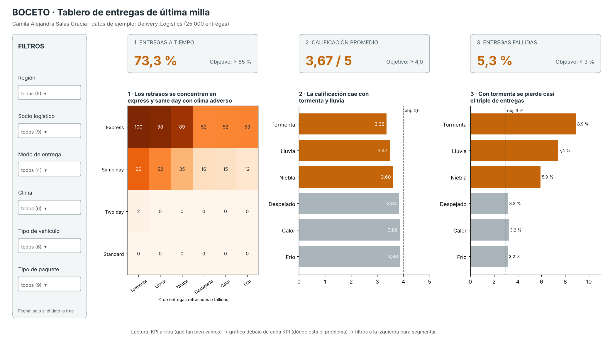

# Semana 13 · Diseña un dashboard

```python
FULL_NAME   = "Camila Alejandra Salas Gracia"
GITHUB_USER = "casalas-2024a-cell"
```

Asignatura: Ciencia de Datos · Ingeniería Industrial · CORHUILA · 2026-B · Corte 3.
Guía de la actividad: *Semana 13 · Herramientas de visualización y dashboards* (formativa, opcional, sin nota en Moodle).

## Qué se entrega

| Archivo | Contenido |
|---|---|
| [`boceto_dashboard.png`](boceto_dashboard.png) | Boceto del tablero (imagen) |
| [`boceto_dashboard.py`](boceto_dashboard.py) | Script que dibuja el boceto con los datos reales (`python boceto_dashboard.py`, necesita `10-week` al lado) |
| Este README | Proceso, KPIs con objetivo, filtros y justificación de la jerarquía visual |



## 1. Proceso elegido

**Entregas de última milla** (calidad del servicio de una operación logística), con el dataset de las semanas 6 a 10: 25 000 entregas, 9 socios, 5 regiones, 4 modos de entrega y 6 condiciones de clima. Quien usa el tablero es el jefe de operaciones, que necesita saber en segundos si el servicio va bien y dónde se está fallando.

## 2. Los 3 KPI y su objetivo

| # | KPI | Definición | Valor actual | Objetivo propuesto |
|---|---|---|---:|---:|
| 1 | **Entregas a tiempo** | Entregas con estado `delivered` ÷ total de entregas × 100 | 73,3 % | ≥ 85 % |
| 2 | **Calificación promedio** | Promedio de `delivery_rating` (1 a 5) | 3,67 | ≥ 4,0 |
| 3 | **Entregas fallidas** | Entregas con estado `failed` ÷ total × 100 | 5,3 % | ≤ 3 % |

Los valores actuales salen del archivo; los objetivos son **propuestos** para el ejercicio (el dataset no trae metas de la empresa). Cada KPI mide algo distinto: puntualidad, experiencia del cliente y pérdida total de la entrega.

## 3. Qué gráfico acompaña a cada KPI

| KPI | Gráfico | Por qué ese gráfico |
|---|---|---|
| 1 Entregas a tiempo | Mapa de calor modo de entrega × clima (% retrasadas) | Muestra dónde se concentra el problema: express y same day con clima adverso |
| 2 Calificación | Barras horizontales por clima, con la línea del objetivo (4,0) | Compara categorías y deja ver cuáles quedan por debajo de la meta |
| 3 Fallidas | Barras horizontales por clima, con la línea del objetivo (3 %) | Igual que el anterior: el clima adverso se separa del resto |

## 4. Filtros

1. Región (5)
2. Socio logístico (9)
3. Modo de entrega (4)
4. Clima (6)
5. Tipo de vehículo (6)
6. Tipo de paquete (9)

No hay filtro de fecha porque el dataset original no la trae (en la semana 11 se simuló un calendario solo para practicar series de tiempo); con fecha real sería el primer filtro y el KPI 1 se vería también como serie mensual.

## 5. Justificación de la jerarquía visual

- **Arriba, los tres KPI en tarjetas grandes:** lo primero que necesita el jefe de operaciones es saber si el servicio cumple o no; el número grande y la meta al lado responden eso sin leer nada más. Van en naranja porque hoy los tres están fuera del objetivo.
- **Debajo, un gráfico por KPI en el mismo orden:** el ojo baja de «cómo vamos» a «dónde está el problema». El mapa de calor es el más ancho porque el KPI 1 es el más importante.
- **A la izquierda, los filtros:** son una herramienta de apoyo, no el mensaje; por eso quedan al costado y en gris suave.
- **Color con propósito:** naranja solo para lo que está mal (KPI fuera de meta, clima adverso) y gris para lo normal. Cada título de gráfico dice la conclusión.

## Cómo se cubre la rúbrica

| Criterio | Dónde está |
|---|---|
| KPIs con objetivo (40) | Sección 2: tres KPI relevantes, cada uno con definición, valor actual y objetivo |
| Boceto: gráficos y filtros (40) | Imagen, sección 3 (gráfico por KPI) y sección 4 (filtros) |
| Jerarquía visual justificada (20) | Sección 5 |

## Cómo entregarlo por GitHub

```bash
git add 13-week
git commit -m "Entrega semana 13"
git push
```
