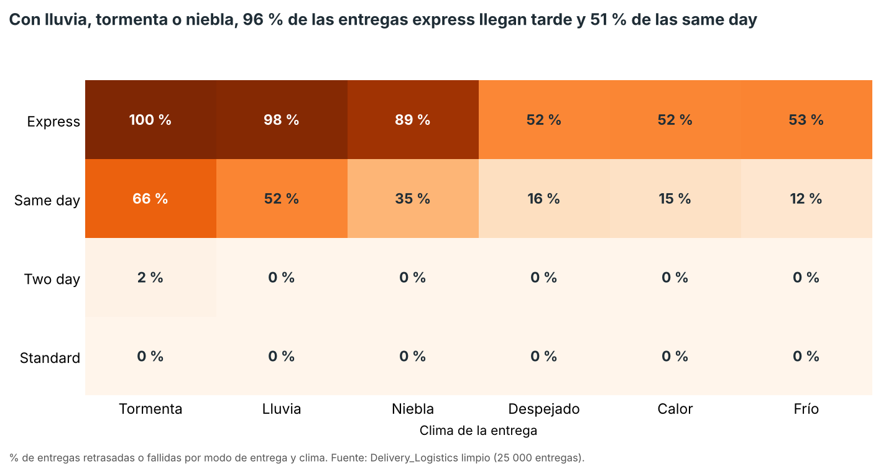

# Semana 15 · Storytelling del proyecto final

```python
FULL_NAME   = "Camila Alejandra Salas Gracia"
GITHUB_USER = "casalas-2024a-cell"
```

Asignatura: Ciencia de Datos · Ingeniería Industrial · CORHUILA · 2026-B · Corte 3.
Guía de la actividad: *Semana 15 · Cierre del curso y proyecto final* (formativa, opcional, sin nota en Moodle).

**Proyecto final:** análisis de las entregas de última milla con el flujo de la semana 10 (extraer → limpiar → cargar en SQLite → analizar).

## Qué se entrega

| Archivo | Contenido |
|---|---|
| Este README | La narrativa de una página (contexto → pregunta → hallazgo → recomendación) |
| [`captura_grafico_clave.png`](captura_grafico_clave.png) | Captura del gráfico clave |
| [`vista_1_kpis.png`](vista_1_kpis.png), [`captura_grafico_clave.png`](captura_grafico_clave.png) (vista 2), [`vista_3_calificacion_fallidas.png`](vista_3_calificacion_fallidas.png) | Vistas del tablero, cada una con un título que expresa su conclusión |
| [`vistas_storytelling.py`](vistas_storytelling.py) | Script que calcula las cifras y dibuja las tres vistas (necesita `10-week` al lado) |

El video de 2 minutos es opcional y no se incluye.

---

## La historia en una página

**1. Contexto.** Una operación de última milla con 25 000 entregas, 9 socios logísticos, 5 regiones y 4 modos de entrega. El servicio no cumple: **26,7 %** de las entregas llegan tarde o fallan y la calificación promedio es 3,67 sobre 5. Cuando la entrega llega tarde, el cliente califica 2,18; cuando llega a tiempo, 4,21.

**2. Pregunta.** ¿Dónde se concentran los retrasos y las fallas, y qué puede hacer la operación para reducirlos? Revisé el socio logístico, la región, el vehículo, el modo de entrega y el clima.

**3. Hallazgo.** El problema no está en quién entrega ni en dónde: los 9 socios van de 24,8 % a 28,3 % de retrasos y las regiones y los vehículos son casi iguales. Está en el **modo de entrega combinado con el clima**. Las entregas standard y two day casi nunca se retrasan (0,2 %), mientras que **53,1 %** de las express y same day llegan tarde, y con lluvia, tormenta o niebla la cifra sube a **73,3 %** (6 211 entregas): **96 %** de las express y **51 %** de las same day. Con tormenta, además, fallan 8,9 % de las entregas frente a 3,2 % con clima normal.



**4. Recomendación accionable.** Hacer un **piloto de 8 semanas** en el que, cuando el pronóstico sea lluvia, tormenta o niebla, no se prometa el modo express: se ofrece same day o two day con plazo mayor. **Responsable:** jefe de operaciones. **Meta medible:** bajar el % de entregas express y same day retrasadas con clima adverso de **73,3 % a 50 % o menos** en 8 semanas, sin que la calificación promedio baje de 3,67 y con fallidas en 5,3 % o menos. Se mide cada semana con el tablero. **Cautela:** cambiar el plazo prometido reduce los retrasos por definición, así que el piloto debe vigilar también la calificación y la demanda; además, esto es una asociación en un archivo que parece sintético, no una prueba de causa.

---

## Revisión de títulos del tablero

| Vista | Título (conclusión, no etiqueta) |
|---|---|
| 1 · KPI | «Una de cada 4 entregas llega tarde o falla, y los clientes lo castigan: 2,2 frente a 4,2 estrellas» |
| 2 · Gráfico clave | «Con lluvia, tormenta o niebla, 96 % de las entregas express llegan tarde y 51 % de las same day» |
| 3 · Calificación y fallidas | «La calificación cae a 3,35 con tormenta» · «Con tormenta fallan 8,9 % de las entregas, casi el triple que sin clima adverso» |

Los títulos descriptivos como «% de retrasos por modo y clima» pasaron al pie de cada gráfico.

## Cómo se cubre la rúbrica

| Criterio | Dónde está |
|---|---|
| Storytelling, de contexto a recomendación (55) | «La historia en una página» (cuatro pasos en orden) |
| Títulos con conclusión (20) | Tabla de revisión de títulos y las tres vistas |
| Recomendación accionable (25) | Punto 4: responsable, acción, meta medible, plazo y forma de medirla |

## Cómo entregarlo por GitHub

```bash
git add 15-week
git commit -m "Entrega semana 15"
git push
```
